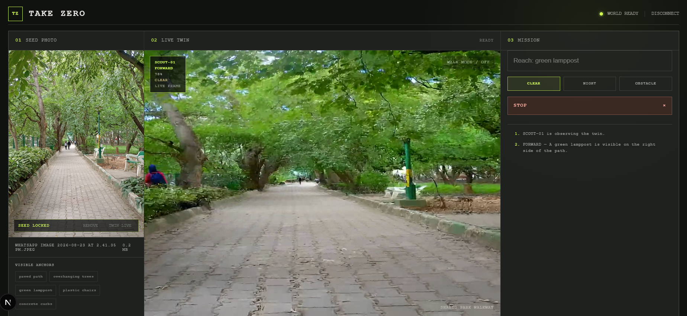
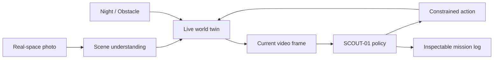

# TAKE ZERO

### A world model that rehearses before reality moves.

**Photo-grounded world twin  |  Live scout policy  |  In-session what-if replanning**

Built for **Inception Hackathon 2.0**  |  Robotics & Simulation



---

## The premise

Most navigation tools answer one static question: *what is in this image?* Take Zero asks a more useful one:

> **What happens to this route when the world changes - before anyone takes it?**

Take Zero begins with a real photo of a space. It turns that image into a live, first-person world twin, gives an autonomous scout a concrete visual mission, and keeps the scout inside a visible observe -> act -> reassess loop as the scene evolves.

It is not a route overlay, a one-shot image caption, or a physical robot controller. It is an **inspectable rehearsal layer** for short, real-world routes.

| Input | Live system | Output |
| --- | --- | --- |
| A single photo of a real space | A persistent first-person world twin with a constrained scout policy | An auditable sequence of observations, commands, and route decisions |

## The Take Zero loop



The important property is persistence: a changed condition updates the active world instead of throwing away the session. SCOUT-01 sees the changed twin and chooses again.

## What the product does

### 1. Grounds a live twin in a real photo

The seed image is converted into a static, geometry-aware scene prompt and a set of visible anchors. The prompt preserves the visual evidence in the photograph - layout, materials, depth, lighting, and orientation - before the live session begins.

### 2. Rehearses a specific mission

The user gives SCOUT-01 a concrete, visible goal:

```text
Reach the green lamp post on the right.
```

The scout does not receive an unconstrained free-form task. It receives the current twin frame, the mission, the active condition, recent context, and its previous command.

### 3. Makes its behavior inspectable

Every decision is surfaced as an applied command plus a grounded observation:

```text
FORWARD     - A green lamp post is visible on the right.
FORWARD     - The target remains beside the path.
HOLD        - Scout pauses to reassess the route.
LOOK RIGHT  - The target is close beside the path.
```

The interface also exposes the active condition, confidence, scout state, and frame source. `LIVE FRAME` confirms that SCOUT-01 is observing the evolving twin rather than only the original photo.

### 4. Replans when the world changes

Take Zero can rewrite the active twin in place:

| Condition | World update | Expected scout behavior |
| --- | --- | --- |
| `CLEAR` | Restores the photo-grounded baseline | Continue or complete the mission |
| `NIGHT` | Rewrites ambient visibility and illumination | Reassess visual confidence and route choice |
| `OBSTACLE` | Introduces a route obstruction | Stop, turn, back up, or choose a new next action |

## Why this is different

| Typical image workflow | Take Zero |
| --- | --- |
| One static image analysis | A live, first-person world twin |
| Natural-language answer | Persistent action-observation loop |
| Scenario change means starting over | Scenario change updates the existing session |
| Opaque agent behavior | Commands, live-frame state, and terminal status are visible |
| Long unconstrained output | Short, landmark-grounded rehearsal with explicit guardrails |

## Control policy

SCOUT-01 is intentionally constrained. That is a product choice, not a missing feature.

```ts
type AgentAction = {
  movement: "idle" | "forward" | "back";
  look_horizontal: "idle" | "left" | "right";
  look_vertical: "idle";
  say: string;
  status: "progress" | "done" | "stuck";
  confidence: number;
};
```

The client enforces four rules around this policy:

1. **Move or turn, never both.** A combined move-and-turn request becomes a stationary turn.
2. **Reassess after short advances.** After two forward decisions, the scout holds position and receives a new live frame.
3. **Keep the goal stable.** Manual walking and mission editing are disabled while the scout runs.
4. **End safely.** A run resolves as `DONE`, `STUCK`, `ERROR`, or `TIMEBOXED`; it cannot run indefinitely.

This makes the behavior easier to read, easier to demonstrate, and more honest about world-model uncertainty.

## Architecture

```text
+------------------------- Browser console -------------------------+
|                                                                    |
|  seed image  ->  scene brief  ->  live twin viewport               |
|                                      |                             |
|                           captured current frame                   |
|                                      |                             |
|  mission + condition + log  ->  SCOUT-01 decision  ->  controls    |
|                                      |                             |
|                        command log + HUD state                     |
+-------------------------------------+------------------------------+
                                      |
                                      v
+------------------------ Server routes -----------------------------+
|  /api/describe     photo -> landmarks + base world prompt          |
|  /api/reactor/token scoped token for the live world session        |
|  /api/act          current frame -> validated scout action         |
+-------------------------------------+------------------------------+
                                      |
                                      v
+----------------------- World-model layer --------------------------+
|  LingBot World 2 session: seed image, active prompt, live video,   |
|  motion controls, and in-session condition updates                 |
+--------------------------------------------------------------------+
```

### Prompt composition

The world prompt is assembled from independent layers:

```text
photo-grounded base scene + movement state + scenario condition
```

This separation matters. A condition update changes the live world without replacing the original visual grounding, while movement state prevents the agent from asking the twin to be still and moving at the same time.

### Decision cadence

Every three seconds during a rehearsal, the browser captures the current twin frame and sends it with:

- the mission;
- the current scenario condition;
- the recent mission log;
- the previous structured action.

The server validates the structured response before the browser applies it. If a decision is unavailable or malformed, the scout stops and exposes an error instead of pretending to be stuck.

## Repository map

```text
app/
  api/act/route.ts            SCOUT-01 decision endpoint
  api/describe/route.ts       photo understanding endpoint
  api/reactor/token/route.ts  scoped world-session token endpoint
  page.tsx                    console and rehearsal orchestration
  globals.css                 visual system
components/
  WorldSession.tsx            live world-session bridge
lib/
  frame.ts                    current video-frame capture
  prompt.ts                   base, movement, and scenario prompt layers
```

## Technology

- Next.js 15
- React 19
- TypeScript
- Reactor
- LingBot World 2

## Local development

### Requirements

- Node.js 20+
- pnpm
- Reactor access with LingBot World 2 enabled
- Private server-side credentials for the photo-understanding and scout-policy routes

### Environment

Create `.env.local` locally and keep it out of version control.

```bash
REACTOR_API_KEY=your_key_here
AI_PROVIDER=anthropic
AI_API_KEY=your_private_key_here
# Optional when AI_PROVIDER=anthropic
# ANTHROPIC_MODEL=claude-sonnet-4-6
```

`AI_API_KEY` is an Anthropic API key used server-side by `/api/describe` to understand the seed photo and `/api/act` to choose SCOUT-01 actions. Set `AI_PROVIDER=anthropic`. `ANTHROPIC_MODEL` optionally selects the model and defaults to `claude-sonnet-4-6`. None of these values are sent to the browser. Keep them out of version control and configure the same variables in the deployment environment.

### Run

```bash
pnpm install
pnpm dev
```

Production check:

```bash
pnpm build
pnpm start
```

## Scope

Take Zero is a hackathon prototype for short, landmark-based rehearsals. Generated worlds can drift over long or ambiguous routes, so the product deliberately keeps the route short, the target visible, and the system state exposed.

It does not claim collision-free navigation, physical-world guarantees, or control of a real robot.

---

